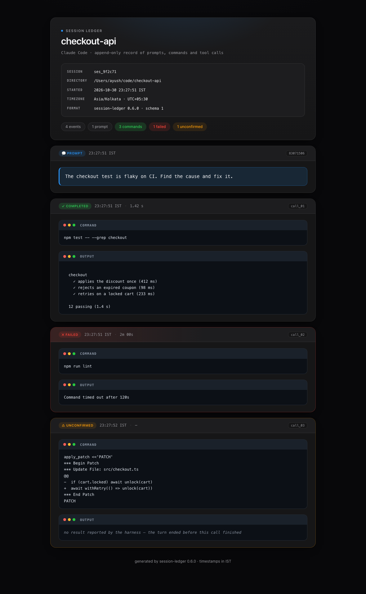

<div align="center">

# 🗂 session-ledger

**Every prompt, every command, every tool call your agent made — in one file per session.**

Append-only, harness-agnostic, and readable a year later without the tool that wrote it.

[](package.json)
[](package.json)
[](tests)
[](package.json)
[](LICENSE)



<sub>A real generated page. No JavaScript, no network requests, one dark theme.</sub>

<sub>[Install](#install) · [Harnesses](#harnesses) · [What gets written](#what-gets-written) · [Configuration](#configuration) · [CLI](#cli) · [Privacy](#privacy) · [Limits](#limits)</sub>

</div>

---

## Why this exists

Your agent already knows what it did. A month later, you don't.

Terminal scrollback is gone, chat history lives in a database you can't grep, and the
one thing you actually need — *what exactly did it run against production?* — was
never written down. session-ledger writes it down as it happens, in plain text you
can `cat`, `grep`, `diff` and commit.

| | |
| :--- | :--- |
| **Records** | 💬 prompts · shell commands · 🛠 every other tool and MCP call |
| **Writes** | one `.md` per session, plus a self-contained `.html` view |
| **Needs** | `node` ≥ 18. No SDK, no server, no build step, no dependencies |
| **Works with** | OpenCode, Claude Code, Cursor, Codex, or anything that can pipe JSON to a hook |

---

## Install

```bash
git clone https://github.com/ay-garg/session-ledger.git
cd session-ledger
node bin/session-ledger.js show-config
```

`show-config` prints every resolved setting **and where each value came from** — the
fastest answer to "why is it writing there?". Nothing is installed globally; every
example below runs `node bin/session-ledger.js`, or `npm link` once in the clone if
you would rather type `session-ledger`.

### Verify in 30 seconds, no harness involved

```bash
printf '%s' '{"hook_event_name":"UserPromptSubmit","session_id":"demo","cwd":"/tmp","prompt":"Fix the checkout test"}' \
  | node bin/session-ledger.js hook --harness demo --tz Asia/Kolkata --dir /tmp/session-ledger-demo

printf '%s' '{"hook_event_name":"PostToolUse","session_id":"demo","tool_name":"Bash","tool_input":{"command":"echo hello"},"cwd":"/tmp","tool_response":{"stdout":"hello"}}' \
  | node bin/session-ledger.js hook --harness demo --tz Asia/Kolkata --dir /tmp/session-ledger-demo

open /tmp/session-ledger-demo/*.html   # or: sed -n '1,40p' /tmp/session-ledger-demo/*.md
```

Two files appear: `2026-…-demo.md` and `2026-…-demo.html`, one 💬 and one ✅ entry, in
`Asia/Kolkata`. If that works, the only remaining variable is the harness wiring.

---

## Harnesses

| Harness | Support | One-line setup |
| :--- | :--- | :--- |
| **OpenCode 2.x** | ✅ verified live | plugin import in `~/.config/opencode/plugins/` |
| **Claude Code** | ✅ verified live | merge `hooks` into `settings.json` |
| **Codex** | ✅ verified live | copy `adapters/codex/hooks.json` to `~/.codex/` |
| **Cursor** | ✅ hook payloads | copy `adapters/cursor/hooks.json` to `~/.cursor/` |
| **Anything else** | ✅ by contract | pipe JSON to `hook` — [see the contract](#any-other-harness) |

Every adapter ships in [`adapters/`](adapters). All of them call the same binary; the
harness JSON differs, the ledger does not.

### OpenCode 2.x

Keep machine-local paths in the wrapper, leave the adapter in the repo:

```ts
// ~/.config/opencode/plugins/session-ledger.ts
process.env.SESSION_LEDGER_DIR ??= "/path/to/your/logs"
process.env.SESSION_LEDGER_SCOPE ??= "/path/to/your/projects"

export { default } from "/absolute/path/to/session-ledger/adapters/opencode/entry.mjs"
```

Import `entry.mjs`, **not** `plugin.js`: OpenCode's resolver looks for a neighbouring
`.ts` file when handed a `.js` import, and fails when the repo has none. Reload with
`opencode api post /api/location/reload` — a running session keeps its old plugin
snapshot until then, so do this before judging it.

<details>
<summary>What the plugin hooks into</summary>

`session.hook("prompt")` for prompts, `execute.before` / `execute.after` for every
tool. It records the exact text, tool name, input, output, working directory and a
measured duration.

</details>

### Claude Code

Merge the `hooks` object from
[`adapters/claude-code/settings.example.json`](adapters/claude-code/settings.example.json)
into `~/.claude/settings.json` (or a project's `.claude/settings.json`), replacing the
placeholder path:

```json
{
  "hooks": {
    "UserPromptSubmit": [
      { "hooks": [{ "type": "command",
        "command": "node /absolute/path/to/session-ledger/bin/session-ledger.js hook --harness claude-code" }] }
    ],
    "PreToolUse": [
      { "matcher": "*", "hooks": [{ "type": "command",
        "command": "node /absolute/path/to/session-ledger/bin/session-ledger.js hook --harness claude-code" }] }
    ],
    "PostToolUse": [ … same matcher and command … ],
    "PostToolUseFailure": [ … same matcher and command … ]
  }
}
```

`"matcher": "*"` makes every tool fire the hook, not just `Bash`; non-shell tools
become 🛠 entries. Claude Code supplies `duration_ms`, so durations are the tool's own
measurement, not a wall-clock guess. Restart, or open `/hooks`, to confirm.

Verified live, including headless `claude -p "…"`. If you run several profiles via
`CLAUDE_CONFIG_DIR`, each has its own `settings.json` — add the hooks to each one you
want recorded.

### Codex

Copy [`adapters/codex/hooks.json`](adapters/codex/hooks.json) to `~/.codex/hooks.json`
(or `<repo>/.codex/hooks.json`), replacing the path:

```json
{
  "description": "Record every prompt, command and tool call Codex runs as a markdown ledger.",
  "hooks": {
    "UserPromptSubmit": [
      { "hooks": [{ "type": "command", "timeout": 10,
        "command": "node /absolute/path/to/session-ledger/bin/session-ledger.js hook --harness codex" }] }
    ],
    "PreToolUse": [
      { "matcher": "*", "hooks": [{ "type": "command", "timeout": 10,
        "command": "node /absolute/path/to/session-ledger/bin/session-ledger.js hook --harness codex" }] }
    ],
    "PostToolUse": [ … same matcher and command … ],
    "Stop": [ … same command, no matcher … ]
  }
}
```

`Stop` is not decoration. Codex fires `PreToolUse` for `apply_patch` but **never**
`PostToolUse` for it, so a file edit would otherwise vanish from the record. At
`Stop`, anything that started and never reported back is written with ⚠️ and its
patch, instead of being dropped.

> [!IMPORTANT]
> Codex requires hooks to be **trusted** before they run. The first interactive launch
> shows a *Hooks need review* dialog — choose **Trust all and continue**. Headless runs
> (`codex exec`) skip untrusted hooks *silently*, so either trust once in the TUI, or
> add `--dangerously-bypass-hook-trust` to automation that already vets the file.
> Editing `hooks.json` invalidates the trust, so re-trust after any change.

Profiles (`$CODEX_HOME/<name>.config.toml`) share one hooks file: `~/.codex/hooks.json`
covers every profile, including `codex --profile …`. Verified live against Codex 0.165
with a custom provider profile.

### Cursor

Copy [`adapters/cursor/hooks.json`](adapters/cursor/hooks.json) to
`~/.cursor/hooks.json` for every project, or `<repo>/.cursor/hooks.json` for one:

```json
{
  "version": 1,
  "hooks": {
    "beforeSubmitPrompt": [
      { "command": "node /absolute/path/to/session-ledger/bin/session-ledger.js hook --harness cursor" }
    ],
    "preToolUse": [
      { "command": "node /absolute/path/to/session-ledger/bin/session-ledger.js hook --harness cursor" }
    ],
    "postToolUse": [ … same command … ],
    "postToolUseFailure": [ … same command … ]
  }
}
```

No `matcher` means every tool is recorded, MCP tools included.

> [!WARNING]
> Cursor **blocks the tool call** if a permission hook prints anything that is not
> valid JSON. session-ledger detects Cursor's `preToolUse` payload and answers
> `{"permission":"allow"}` before writing anything, so the call proceeds. Do not pipe
> that command's output anywhere else.

### Any other harness

If the harness can run a shell command at "prompt submitted", "before tool" and
"after tool", and sends a JSON object on stdin, it already works.

| Field | Required | Notes |
| :--- | :--- | :--- |
| `hook_event_name` (or `hookEventName`) | yes | `UserPromptSubmit` / `beforeSubmitPrompt` for prompts; `PreToolUse` / `PostToolUse` / `PostToolUseFailure` for tools; optional `Stop` / `SessionEnd` to flush calls that never reported back |
| `session_id` | yes | Also accepted: `conversation_id`, `thread_id`, `sessionId` |
| `prompt` | prompts | Also accepted: `user_prompt`, `userPrompt`, `message`, `text` |
| `tool_name` | tools | `Bash` / `Shell` / `exec_command` / `terminal` / `sh` / `zsh` are shell commands; everything else is a tool call |
| `tool_input.command` | shell | Also accepted: `tool_input.cmd`, top-level `command` |
| `tool_input` | tools | Recorded as the tool's JSON input |
| `cwd` | no | Falls back to `tool_input.working_directory`, `workspace_roots[0]`, process cwd |
| `tool_response` / `tool_output` / `output` | no | Unwrapped to readable text; JSON strings and `{stdout,stderr}` shapes are understood |
| `duration_ms` / `duration` | no | Milliseconds; without it the start event's timestamp measures the call |

An "after tool" event with no "before" still records the call — only the duration
shows `—`. A harness with no prompt event records commands and tools, but no 💬.

---

## What gets written

One markdown file and one HTML page per session, named
`<YYYY-MM-DD>-<session-id>`, dated by the first recorded event in your timezone. A
session that crosses midnight keeps its original file.

````markdown
# 🗂 Session Ledger

| | |
| :--- | :--- |
| **Session** | `ses_9f2c71` |
| **Harness** | Claude Code |
| **Directory** | `/Users/ayush/code/checkout-api` |
| **Started** | 2026-10-30 23:17:04 IST |
| **Timezone** | `Asia/Kolkata` · UTC+05:30 |
| **Format** | session-ledger `0.6.0` · schema 1 |

### 💬 23:17:04 IST · `82424858`

```text
The checkout test is flaky on CI. Find the cause and fix it.
```

### ✅ 23:17:05 IST · 1.42 s · `call_01`

```bash
npm test -- --grep checkout
```

```text
12 passing (1.4 s)
```
````

The markdown is the record: `cat` it, grep it, diff it, commit it, read it on GitHub.
Entries append in the order they **finished**, so a nested subagent call can land after
the tools it spawned — its own timestamp still shows when it started. The header is
written once; entries are never rewritten.

- **Entry IDs** come from the harness's message or tool-call ID, so they are stable and
  unique within a session.
- **Nothing is silently truncated.** Prompt text, tool input and output are clipped at
  `maxOutput`; the entry says exactly how many characters were dropped.
- **Safe fences.** A prompt containing ```` ``` ```` gets a longer fence instead of
  breaking the document.
- **Empty output** is written as `(no output)` rather than an invisible blank.
- **Turn end flushes the leftovers.** A call the harness never reported back is written
  as ⚠️, not lost.

### Statuses

`✅ completed` / `❌ failed` describe **the tool call**, not the command's exit code.

| Mark | Means |
| :--- | :--- |
| ✅ | The harness reported the call finished |
| ❌ | The harness reported a failure, interrupt, permission denial or error object |
| ⚠️ | The harness announced the call, then ended the turn without a result (Codex `apply_patch`); input kept, output not invented |
| 💬 | A user prompt — not a tool call, so it has no status |

A shell command that exits `1` normally is still ✅, with `Exit code 1` visible in the
output. Nothing parses exit codes out of free-form text; guessing would be worse than
not guessing. Codex has no failure hook at all, so a non-zero exit arrives as a normal
`PostToolUse` and stays ✅ with the error in the output.

### The HTML page

The page next to the markdown is a view, not a second record: one file, no JavaScript,
no network requests, no remote fonts, and one look — dark, like the terminal the work
happened in. Nothing follows the operating system theme, so a page looks the same on
every machine it is opened on. It is rewritten under a short per-page lock, so parallel
tool calls cannot corrupt it.

```bash
session-ledger render --dir ~/session-logs   # restyle existing pages in place
```

`render` swaps the stylesheet, the theme attributes and the one-line description,
leaves entries untouched, and takes the same lock the hooks take — safe while a
session is live. An entry is never re-parsed or reordered.

### Timezones

Every timestamp is formatted with an explicit IANA zone through `Intl.DateTimeFormat`,
never the process's `TZ`. A hook launched from a container running `TZ=UTC` cannot
shift the record. Each header records the zone name *and* the offset at that instant,
so DST changes and abbreviations like `IST` stay unambiguous.

---

## Configuration

| Key | Flag | Env var | Default | Meaning |
| :--- | :--- | :--- | :--- | :--- |
| `dir` | `--dir` | `SESSION_LEDGER_DIR` | `~/.session-ledger` | Where `.md` / `.html` files go |
| `timezone` | `--tz` | `SESSION_LEDGER_TZ` | machine zone | IANA zone for timestamps and the filename date |
| `scope` | `--scope` | `SESSION_LEDGER_SCOPE` | every session | Only record sessions under this path |
| `maxOutput` | `--max-output` | `SESSION_LEDGER_MAX_OUTPUT` | `20000` | Characters kept per prompt, input and output |
| `prompts` | `--no-prompts` | `SESSION_LEDGER_PROMPTS` | `true` | Record user prompts |
| `tools` | `--no-tools` | `SESSION_LEDGER_TOOLS` | `true` | Record non-shell tools; shell commands are always recorded |
| `html` | `--no-html` | `SESSION_LEDGER_HTML` | `true` | Set `false` / `0` / `no` to skip the page |

Precedence, later only when earlier is absent: **flag → environment → config file →
default**. The config file lives at `~/.config/session-ledger/config.json`:

```json
{ "dir": "~/session-logs", "timezone": "Asia/Kolkata", "scope": "~/code",
  "maxOutput": 20000, "prompts": true, "tools": true, "html": true }
```

Notes that save debugging time:

- `~` is expanded; relative paths resolve against the hook's working directory, which is
  the agent's session directory.
- An unknown `timezone` prints a warning and falls back to the machine zone rather than
  writing broken timestamps.
- `scope` matches the **session directory** the harness reports, not a directory a
  command later `cd`s into. Point it at the parent of your projects.
- `--harness` is a label for the header only; it does not change parsing.
- `--no-tools` never hides shell commands, and `--no-prompts` never touches commands or
  tools. Prompts can be off alone if what you type is more sensitive than what runs.
- Environment variables suit a one-off run; the config file suits hooks, which do not
  inherit your shell aliases or exports.

---

## CLI

```
session-ledger hook        read one hook event on stdin and append it
session-ledger render      restyle every .html page in the output directory
session-ledger show-config print resolved configuration and its sources
session-ledger help        usage
session-ledger --version   version
```

`hook` exits `0` for normal operation and for malformed or unknown events, writing any
complaint to stderr: a logging hook must never break the agent it observes. A genuine
write failure (permissions, disk full) exits `1` and says which path — never silent.

Flags accepted by `hook` and `show-config`: `--dir`, `--tz`, `--scope`, `--max-output`,
`--no-prompts`, `--no-tools`, `--no-html`, `--config`. `hook` also accepts
`--harness <label>`; `render` reads `--dir` and `--config`.

---

## How it works

```
harness hook ──▶ session-ledger hook ──▶ 2026-10-30-<session>.md     append-only record
  (JSON stdin)         │
                       └──────────────▶ 2026-10-30-<session>.html   rewritten view
```

`core/normalize.js` is the only file that knows any harness's payload shape. Everything
after it — entry IDs, clipping, fences, status, timezone formatting, file naming,
locking — is shared, which is why adding a harness takes one function rather than a
fork.

---

## Privacy

> [!CAUTION]
> Prompts, tool inputs and outputs are recorded **verbatim**, with no redaction. Secrets
> land on disk in full: a `curl -H "Authorization: Bearer …"` and a pasted API key are
> both in the file.

- Keep the output directory out of version control.
- Use `scope` to limit recording to the projects you intend to audit; `--no-prompts` and
  `--no-tools` narrow what is captured.
- Treat the log directory as sensitive as your shell history — arguably more, because it
  also holds what you asked and what the agent read.

The HTML page makes no network requests and loads no remote fonts, so opening it leaks
the ledger nowhere.

---

## Limits

| Harness | Verified | Known gaps |
| :--- | :--- | :--- |
| OpenCode 2.x | live | Duration includes manual-approval wait; timestamp is request time, not process spawn |
| Claude Code | live | Hooks must be trusted and enabled; only events you configure are recorded |
| Cursor | hook payloads | Requires a valid JSON reply on permission hooks |
| Codex | live | No failure event and no `duration_ms`; `apply_patch` has no result hook, so it lands ⚠️ at turn end |
| Anything else | by contract | Only what the harness emits; no prompt event means no 💬 entries |

<details>
<summary>Other deliberate limits</summary>

- Commands run through a wrapper (RTK, `nice`, a shell function) are recorded as the
  wrapper saw them, not as the deeper process ran them.
- Tool input is what the harness reports; a tool that mutates arguments after the hook
  fires will differ from what the ledger shows.
- Subagent turns appear only if the harness routes their tool calls through the same
  hook events.
- The HTML loses an entry if a process is killed while holding its lock; the markdown is
  never locked and never loses one.
- An `.html` keeps the stylesheet it was created with until you run
  `session-ledger render`; the header card keeps its original wording.
- There is no rotation or retention policy. One file per session, forever.

</details>

---

## Troubleshooting

| Symptom | Likely cause | Fix |
| :--- | :--- | :--- |
| No file at all | Session directory outside `scope` | Compare the harness's directory with `show-config`; widen or drop `scope` |
| No file at all (Cursor) | The permission hook's stdout was piped or swallowed | Run the command as-is; Cursor needs its `{"permission":"allow"}` reply |
| No file at all (Codex) | Hooks never trusted | Open `/hooks`, review, trust; Codex skips silently until then |
| No file at all (OpenCode) | Plugin not reloaded, or it failed to load | `opencode api post /api/location/reload`; import `entry.mjs`, not `plugin.js` |
| Commands recorded, tools missing | Hook matcher is narrower than `*` | Use `"matcher": "*"` (Claude Code, Codex) or omit it (Cursor) |
| Prompts recorded, nothing else | Only prompt hooks were wired | Add the before/after tool events too |
| Every call appears twice | Hooks configured globally **and** in a project `.claude/settings.json` | Keep one of the two |
| Wrong clock | `timezone` left at the machine default | Pin it: `--tz Asia/Kolkata` or the config file |
| Duration shows `—` | The harness sent no start event, so there is nothing to measure from | Expected for after-only harnesses |
| Page looks like an older version | The stylesheet is written when the page is created | `session-ledger render --dir <dir>` |

---

## Development

```bash
node --test tests/          # 43 unit + end-to-end tests, no dependencies
```

```
bin/session-ledger.js   CLI: hook, render, show-config, flags, pending state
core/ledger.js          timezone formatting, durations, fences, output unwrapping
core/normalize.js       the only file that knows every harness payload shape
core/config.js          flag > env > file > default, scope matching
core/store.js           file naming, append, HTML lock
core/markdown.js        the record
core/html.js            the page: stylesheet and markup
adapters/opencode/      native plugin + entry.mjs for OpenCode's resolver
adapters/claude-code/   settings snippet
adapters/cursor/        hooks.json
adapters/codex/         hooks.json
tests/                  node --test
docs/                   README screenshots
```

Adding a harness means teaching `core/normalize.js` one more payload shape, or — if the
harness has no hooks — writing an adapter that builds `Session` and `Entry` objects and
calls `record()`. Formatting and file writing are shared and should not be duplicated.

---

## License

MIT — see [LICENSE](LICENSE).
